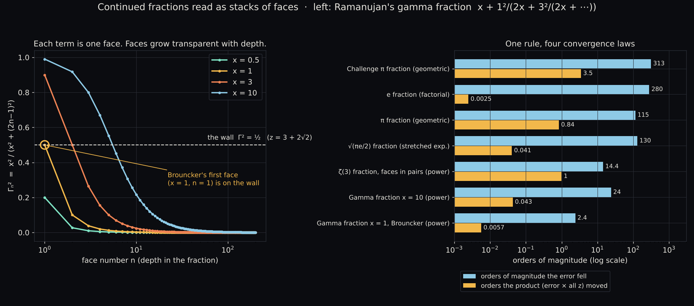

# Ramanujan's Gamma Fractions Read as Stacks of Faces

**Jeromie Beasley** · session record, 13–15 November 2026

*AI-assisted: the questions and direction are the author's; Claude (Anthropic) was used for file retrieval, computation, code and drafting. Every number below comes from a script named in the last section.*

---

## In short

- The projector eye that was calibrated on the Ramanujan Challenge fractions was run, for the first time, on Ramanujan's own continued fractions.
- His gamma-quotient fractions converge by a power law, and the power is the fraction's own parameter x. The challenge fractions all converged geometrically or faster.
- Each term of the gamma fraction can be read as one reflecting face, in the variables of the *Light at the Hypersurface* mixer. Face n has Γ = x/√(x² + (2n−1)²), exactly.
- One rule was then tested on seven fractions that converge by four different laws: the error after N terms, times the product of every face's step ratio z, should stay nearly fixed. It held to within a constant for the factorial, stretched-exponential and gamma fractions, and to within a small power of N for the others. On the ζ(3) fraction it failed with single terms as faces and held with pairs of terms as faces.
- The first face of Brouncker's fraction (x = 1) sits exactly on the wall Γ² = ½, z = 3 + 2√2. That is exact algebra; any physical meaning is untested.

---

## 1. Where the work lives

The Lean library for the Ramanujan Challenge is at `github.com/dicipler-pixel/ramanujan-challenge-lean`.

- On 13 November the branch `phase2-final-ci` (18 October: 153 theorems, 8 false controls, Problem 2.1 closed, the general real Euler integral) was merged into `main`. Before the merge, `main` showed only the 16 October state with 70 theorems.
- Checked on that branch before merging: no unfinished proofs in the Lean files (text search), the 153-name inventory, the repository's three symbolic pre-check scripts, the verifier's 8 regression tests, and an independent exact recomputation of the Problem 2.1 convergents (about 2.09 digits gained per step, target 6/(3 − π) = −42.37507983558627…).
- Not checked: a full Lean rebuild and the hosted CI result. Neither could be reached from the session.

This record and its scripts are on the branch `ramanujan-faces-2026-11-15` of the same repository, under `notes/ramanujan_faces/`.

## 2. The Drive before 2 August, and the Colab notebook

The challenge closed on 1 August 2026. The Drive holds the full run-up:

| Dates | What is there |
| :--- | :--- |
| 21–25 Jul | Problem 2.2 (γ): Master A, Draft v2 through eight saves, FINAL, then four UPDATED PDFs |
| 26 Jul | 2.3 and 2.4 submission zips, `Problem_2_1_fixed.zip`, `solution_2_3.sage` |
| 27–29 Jul | 2.5 (Catalan): four submission zips, five solution PDFs |
| 29–30 Jul | UPDATED tex and PDF for 2.1, 2.3, 2.4, 2.5, and 2.2 at v6 and v7 |
| 31 Jul, 01:06–02:08 | The send-off: 2.1 in four zips, 2.2 in five, 2.3 in three, 2.4 in three, 2.5 in three |
| 31 Jul – 1 Aug | `Problem_2_6_solution.md`, `Problem_2_6.zip`, `Problem_2_5_fixed.zip` |
| 2 Aug onward | The official proofs PDF, then the projector calibration paper |

Only the earliest 2.2 draft (24 July) has been read in this session. The zips are not yet opened.

The Colab notebook from the same window (`Untitled21.ipynb`, 22–25 July, 35 cells) is not Ramanujan data. It is the quantum heat engine single-shot data. What it holds:

- The I/Q shots for the three prepared states fit best with four clouds, not three.
- The leading eigenvector of the population path turns 21.6° per step on average: 29.6° at stroke changes, 20.6° away from them.
- That difference did not survive resampling: 9.3° with a 95% range of −1.5° to 21.2°.
- A geodesic residue measured at 355 on average, against 408–970 from shot noise alone.
- The edge of each cloud is made of the e state and the fourth cloud; the f state is essentially never at the edge.

The first Problem 2.5 submission is dated 27 July, two days after the notebook's last save. The 2.5 work measures how the dominant direction of the Catalan matrix turns (√2/n² per step). The same eye, a turning direction, was too noisy to call on the heat engine data and came out exact on the recurrences. This link is a reading of dates and method, not something written in either file.

## 3. What is known about how Ramanujan worked

- He worked on a slate and copied only finished formulas into notebooks.
- The three notebooks (1903–1914) record results without proofs.
- Only one continued fraction was published in his lifetime; the rest are in the notebooks and the letters to Hardy.
- Berndt, who proved the notebook entries over many years, found no clue to how the continued fractions were discovered, and names the ones for products and quotients of gamma functions as the hardest to explain.
- One later reconstruction (McLaughlin and Wyshinski) proposes that he obtained some entries by extending and contracting known fractions. That is a proposal by later mathematicians.

So any statement of "how he saw it" is a reconstruction. The path was wiped from the slate; only the endpoints were kept.

## 4. The projector eye on his fractions

### The instrument

For a continued fraction with partial numerators b_n and denominators a_n, form the step matrices

M_n = [[0, b_n], [1, a_n]]

multiply them in order, and normalise the product P. The eye reads

Φ = ½ ‖P Pᵀ − Pᵀ P‖²

Once the product has collapsed to rank one, Φ = sin² θ, where θ is the angle between the direction the product sends things to and the direction it reads from. Before full collapse the two differ by a factor (1 − 4δ²), with δ the rank-one residual.

### Why the run can be trusted

- **Controls.** Three fractions with stored answers from the August calibration were run first.
- **No formula on trust.** For every Ramanujan fraction the running value was compared with the closed form. A wrongly stated formula would show an error that does not shrink.

| Control | Stored angle | Measured |
| :--- | :--- | :--- |
| Challenge π fraction (Q1) | 20.5600554° | 20.5600554° at N = 200 |
| e fraction | 30.198408° | 30.127° at N = 800, closing like 1/N |
| π fraction | 15.282434° | 15.253° at N = 800, closing like 1/N |

### Results

| Fraction | Value of the tail | Angle θ | Collapse of the product to rank one |
| :--- | :--- | :--- | :--- |
| Gamma quotient, x = 1 (Brouncker's 4/π) | (4 − π)/π | → 15.28° | like N⁻² |
| Gamma quotient, x = 3 (π = 3 + 1²/(6 + 3²/(6 + …))) | π − 3 | → 8.06° | like N⁻⁴ |
| Gamma quotient, x = 10 | 0.04896 | → 2.80° | like N⁻¹¹ |
| Gamma quotient, x = ½ | 0.34524 | → 19.05° (18.3° at N = 1600) | like N⁻¹·⁵ |
| Two-parameter gamma quotient, x = 3, n = ½ | 0.10660 | → 6.08° | like N⁻⁴ |
| √(πe/2) fraction, 1/(1 + 1/(1 + 2/(1 + 3/(1 + …)))) | 0.65568 | → 33.25° (31.8° at N = 1600) | like e^(−2√N) |
| ζ(3) fraction | ζ(3) − 1 | → 11.42° | like N⁻⁷ (error in the value like N⁻⁶) |
| Rogers–Ramanujan at q = e^(−2π) | 0.99814 | 0.0534° | complete by N = 10 |

The gamma quotient is

4 Γ((x+3)/4)² / Γ((x+1)/4)²  =  x + 1²/(2x + 3²/(2x + 5²/(2x + …)))

### What the eye saw

1. **Power-law collapse, with the power set by x.** The error in the value falls like N⁻ˣ and the rank-one residual like N⁻⁽ˣ⁺¹⁾. Measured exponents of the error between N = 800 and 1600: 0.49, 1.00, 3.00, 9.99 for x = ½, 1, 3, 10. In the one two-parameter case run (x = 3, n = ½) the second parameter did not change the exponent.
2. **At x = 0 the direction never settles.** The step matrices become [[0, m²], [1, 0]]. Two of them multiply to a diagonal matrix, so the product alternates between diagonal and anti-diagonal. It still collapses toward rank one, but onto two directions that alternate, 90° apart, at every step. The running value alternates between 0 and infinity. This is the tied case of Proposition 2 of the calibration paper, which had no calibrated example.
3. **Two roads to one angle.** Brouncker's fraction and the control π fraction have the same tail value and the same angle, 15.28°. Brouncker's value closes like 1/N; the control's value reaches 77 digits by N = 100. The two angles both close like 1/N.
4. **Rogers–Ramanujan is almost perfectly normal.** Its angle is 45° minus the arctangent of its value. The tangent rule for polynomial fractions does not apply because the reading direction sits at 45°, not on an axis.
5. **One constant, two angles.** His ζ(3) fraction sits at 11.42°. Apéry's recurrence for the same constant sits at 2.18° in the August calibration.

For x = 0.2 and 0.05 the measured exponent at N = 1600 is 0.17 and 0.03, below x. In the checker's longer run the x = 0.2 exponent climbs to 0.192 by N = 6.5 million, which is consistent with exponent x and a slow correction. The power law is confirmed for x ≥ ½ and not contradicted below it.

Two values the checker observed and nobody has derived here: error × Nˣ tends to about 0.40528 at x = 1 (4/π² = 0.405285) and to about 0.2500 at x = 3.

## 5. The fraction as a stack of faces

The *Light at the Hypersurface* mixer has one feed operator: a step at a face, with rapidity r = ln z and Γ = tanh(r/2). Its section E stacks faces and checks the stack against a transfer matrix. A continued fraction is the same kind of object: each term is one 2×2 step and the fraction is the stack.

### Derivation: the Γ of each face

Write m = 2n − 1. The step matrix of the gamma fraction is

M_n = [[0, m²], [1, 2x]]

Its characteristic equation is

λ² − 2x λ − m² = 0

so

λ± = x ± s,  with  s = √(x² + m²)

The face's step ratio is the ratio of the two eigenvalue sizes:

z_n = (s + x)/(s − x)

and since tanh(½ ln z) = (z − 1)/(z + 1),

Γ_n = x/s = x / √(x² + (2n − 1)²)

Three consequences, all exact:

- **The wall.** Γ_n² = ½ exactly when 2n − 1 = x. Faces with 2n − 1 < x are above the wall; faces with 2n − 1 > x are below it.
- **Brouncker.** At x = 1 the first face has Γ² = ½ and z = (√2 + 1)/(√2 − 1) = 3 + 2√2.
- **x = 0.** Every face has Γ = 0 and z = 1.

### Why a power law

For deep faces Γ_n is small, so r_n = 2 artanh(Γ_n) ≈ 2x/(2n − 1). The sum of 2/(2n − 1) up to N grows like ln N, so

r_1 + r_2 + … + r_N ≈ x ln N + constant

and the product of the attenuations 1/z_n falls like N⁻ˣ.

### The check

The step matrices do not commute, so it is not automatic that the error of a whole stack is the product of the faces' own attenuations. That has to be measured.

**The rule.** Error after N terms × z_1 z_2 ⋯ z_N stays nearly fixed while the error itself falls by many orders of magnitude.

**Why the gamma fraction alone cannot test it.** For the gamma fraction the product of the z's is itself a constant times Nˣ, so "the product settles" says the same thing as "the error falls like N⁻ˣ", which section 4 already measured. The gamma table below is consistent with the face reading but cannot separate it from a plain power law.

| x | N = 100 | N = 400 | N = 1600 | N = 6400 | Error itself, N = 100 → 6400 |
| :--- | :--- | :--- | :--- | :--- | :--- |
| ½ | 1.379 | 1.423 | 1.444 | 1.455 | 5.4 × 10⁻² → 7.1 × 10⁻³ |
| 1 | 2.2108 | 2.2326 | 2.2381 | 2.2395 | 4.0 × 10⁻³ → 6.3 × 10⁻⁵ |
| 3 | 5.776 | 5.907 | 5.940 | 5.949 | 2.4 × 10⁻⁷ → 9.5 × 10⁻¹³ |
| 10 | 17.89 | 19.28 | 19.64 | 19.74 | 1.5 × 10⁻¹⁹ → 1.5 × 10⁻³⁷ |

These are still creeping at N = 6400; the checker's run to N = 102,400 puts the limits near 1.466, 2.2400, 5.951 and 19.77.

**The test that can fail.** The same rule was applied to fractions that converge by different laws. The kill line was written before the run: if the product moves by more than a slowly varying, power-of-N amount while the error moves by many orders, the rule fails for that fraction.

| Fraction | How it converges | Orders the error fell | Orders the product moved | Reading |
| :--- | :--- | :--- | :--- | :--- |
| e fraction, 1/(1 + 2/(2 + 3/(3 + …))) | factorial | 280.4 | 0.0025 | holds to a constant |
| √(πe/2) fraction | stretched exponential | 130.3 | 0.041 | holds to a constant |
| Gamma fraction, x = 10 | power | 24.0 | 0.043 | holds to a constant |
| Gamma fraction, x = 1 (Brouncker) | power | 2.40 | 0.0057 | holds to a constant |
| π fraction, 1²/(3 + 2²/(5 + …)) | geometric | 114.8 | 0.84 | holds up to about N⁰·⁷ |
| Challenge π fraction (Q1) | geometric | 313.5 | 3.47 | holds up to about N²·⁹ |
| ζ(3) fraction, one term per face | power | 14.4 | 721 | fails this way |
| ζ(3) fraction, one pair of terms per face | power | 14.4 | 1.00 | holds up to about N⁰·⁴ |

The ζ(3) fraction's terms come in pairs (denominators 4, 1, 12, 1, 20, 1, …). With a single term as a face the rule fails outright. With a pair of terms as a face it holds up to a small power of N.

For the challenge π fraction the mean log₁₀ z per face is 2.10, against 2.09 digits gained per step in the independent recomputation of section 1. Its faces keep a nearly fixed z of about 126, which is why it converges geometrically.

### What this lets us see

- **Why his gamma fractions converge slowly.** The faces grow transparent with depth, so the total rapidity grows only like a logarithm. The challenge π fraction's faces keep a nearly fixed z, and it converges geometrically.
- **Why x = 0 never settles on one direction.** Every face has z = 1, so no face favours one direction over the other, and the product alternates between two.
- **The same number is in the challenge spectra.** 3 + 2√2 = (1 + √2)², and the dominant Apéry and Catalan root is (1 + √2)⁴ = 17 + 12√2. So ln(3 + 2√2) is half the logarithm of that dominant root. Measured the way z is defined here, as the ratio of the two roots, the Apéry ratio is (1 + √2)⁸ and the wall rapidity is a quarter of it. This is exact arithmetic and is not explained here.

## 6. Status of each statement

| Statement | Status |
| :--- | :--- |
| Γ_n = x/√(x² + (2n−1)²); wall at 2n − 1 = x; Brouncker's first face at z = 3 + 2√2 | Derived (exact), confirmed numerically |
| Direction flips forever at x = 0 | Derived (exact), confirmed numerically |
| Error ∝ N⁻ˣ for x ≥ ½ | Measured |
| Error ≈ constant × product of 1/z_n: e fraction, √(πe/2) fraction, gamma fractions | Measured, not derived |
| Same rule up to a small power of N: π fraction, challenge π fraction, ζ(3) with paired faces | Measured, not derived; the leftover power is not explained |
| Same rule with single-term faces on the ζ(3) fraction | Failed this way; holds with paired faces |
| Slow convergence of Brouncker-type fractions | Recognised: classical |
| "Exponent equals x" and the face reading as new statements | Prior art not yet searched |
| Physical meaning of Brouncker's face on the wall | Untested |
| Link between the N3 flat-valley card and the x = 0 tie | Analogy only, untested |
| That Ramanujan thought in directions or faces | No historical evidence; not claimed |

## 7. Not done

- The entries Berndt calls most enigmatic (Chapter 12, Entries 34, 39 and 40) were not run. The source chapter could not be retrieved, and they were not typed from recall.
- The late-July zips are unopened beyond the earliest 2.2 draft.
- No prior-art search on the exponent law or on the face rule.
- No derivation of the face rule, and no explanation of the leftover powers of N.
- Zenodo could not be reached from the session, so the Zenodo state of the Ramanujan work is unconfirmed.

## 8. Files

| File | What it does |
| :--- | :--- |
| `ram_eye_01.py`, `out_01.txt` | RAM-EYE-01: three controls, then eight Ramanujan fractions |
| `ram_eye_02.py`, `out_02.txt` | RAM-EYE-02: the gamma fraction at x = 0.2, 0.05 and 0 |
| `ram_eye_03.py`, `out_03.txt` | RAM-EYE-03: per-face Γ and the product on the gamma fraction |
| `ram_eye_04.py`, `out_04.txt` | RAM-EYE-04: the face rule on seven fractions with four convergence laws |
| `ram_eye_05.py`, `out_05.txt` | RAM-EYE-05: the ζ(3) fraction with paired faces |
| `checker/` | An independent checker's own scripts (separate code, 90–110 digits) that re-derived sections 4 to 6 |
| `make_fig.py`, `fig_faces.png` | RAM-EYE-FIG-01: the figure |

Each script runs with Python 3 and `mpmath` (`matplotlib` for the figure): `python3 ram_eye_01.py`.

## Sources

- B. C. Berndt, R. L. Lamphere, B. M. Wilson, "Chapter 12 of Ramanujan's Second Notebook: Continued Fractions", *Rocky Mountain Journal of Mathematics* 15 (1985). https://projecteuclid.org/journals/rocky-mountain-journal-of-mathematics/volume-15/issue-2/Chapter-12-of-Ramanujans-second-notebook-Continued-fractions/10.1216/RMJ-1985-15-2-235.pdf
- B. C. Berndt, "Continued Fractions", in *Ramanujan's Notebooks, Part II* (Springer, 1989). https://doi.org/10.1007/978-1-4612-4530-8_4
- J. McLaughlin, N. J. Wyshinski, "Ramanujan and Extensions and Contractions of Continued Fractions". https://arxiv.org/pdf/math/0402463
- Illinois Center for Advanced Study, "Bruce C Berndt: Ramanujan's Notebooks". https://cas.illinois.edu/node/1890
- *Scientific American*, "One of Srinivasa Ramanujan's Neglected Manuscripts Has Helped Solve Long-standing Mathematical Mysteries". https://www.scientificamerican.com/article/one-of-srinivasa-ramanujans-neglected-manuscripts-has-helped-solve-long-standing-mathematical-mysteries/
- Ramanujan Machine Group, "Ramanujan Challenge Proofs" (Technion, 2 August 2026). https://github.com/RamanujanMachine/RamanujanChallengeSolutions
